# 📊 Awesome Spend Management & Procurement Analytics ⚡

  

  
  
  
  
  
  
  

> 🌟 **A curated directory of top-tier Spend Management and Procurement Analytics platforms** — featuring commercial SaaS powerhouses, AI-driven purchasing agents, corporate card spend automation, and self-hosted open-source Procure-to-Pay (P2P) solutions for full spend visibility, real-time AP automation, and cost intelligence.
> 
> ⭐ *Star this repository if you find it valuable for your finance, procurement, or engineering stack!* ⭐

---

## 📑 Table of Contents

- [🌐 Sector Overview & Market Dynamics](#-sector-overview--market-dynamics)
- [🟦 SaaS & Hosted Platforms](#-saas--hosted-platforms)
  - [Enterprise SaaS Comparison Matrix](#-enterprise-saas-comparison-matrix)
  - [Detailed SaaS Platform Deep Dives](#-detailed-saas-platform-deep-dives)
- [🟩 Open-Source Software](#-open-source-software)
  - [Open-Source Solutions Comparison](#-open-source-solutions-comparison)
  - [Detailed Open-Source Profiles](#-detailed-open-source-profiles)
- [📊 Architectural Comparison at a Glance](#-architectural-comparison-at-a-glance)
- [🔍 SEO Keyword Matrix & Buying Considerations](#-seo-keyword-matrix--buying-considerations)
- [🤝 Contributing](#-contributing)
- [💖 Support](#-support)
- [⭐ Star History](#-star-history)
- [📄 License](#-license)

---

## 🌐 Sector Overview & Market Dynamics

The global **Business Spend Management (BSM) and Procurement Analytics market** is currently estimated at **$30–$35 billion** and projected to surpass **$50 billion by 2030** (expanding at an 11–13% CAGR), with the specialized procurement and spend analytics software segment surging at over **18–22% CAGR** as organizations transition away from legacy ERP spend cubes toward AI-native sourcing and automated taxonomy classification.

The sector is **moderately fragmented**: while legacy enterprise suites (such as Coupa and SAP Ariba) command top-down enterprise spend and complex global P2P workflows, intense competition from high-velocity fintech spend-card disruptors (such as Ramp and Brex) alongside specialized mid-market point tools (such as Spendesk, Pleo, and Procurify) prevents a winner-take-all monopoly, driving continuous innovation across AI purchase agents, real-time budget sync, and cross-border AP automation.

---

## 🟦 SaaS & Hosted Platforms

Commercial, cloud-hosted Spend Management, Corporate Card, and Procurement Analytics platforms.

### 💳 Enterprise SaaS Comparison Matrix

*The table below is sorted by company size (Revenue / Valuation) in descending order:*

| Product 🏢 | Company Scale (Valuation / Revenue) 📈 | Starting Pricing 💰 | Free Tier & Free Trial Limits 🎁 | Core Focus / Sweet Spot 🎯 |
| :--- | :--- | :--- | :--- | :--- |
| **[Ramp](https://ramp.com/)** 🚀 | **Valuation: ~$60B** Revenue: ~$1.5B+ ARR | **$0/month** (Free base tier) Paid: **$15/user/month** (Ramp Plus) | **Free Forever Tier**: Unlimited corporate cards, basic expense tracking, and bill pay at $0 software fee. *Ramp Plus*: 30-day free trial. | Modern corporate cards, real-time budget tracking, and autonomous AI purchasing agents. |
| **[Coupa](https://www.coupa.com/)** 🏢 | **Valuation: $8.0B** (Thoma Bravo PE buyout) Revenue: ~$818M+ TTM | **Custom annual subscription** (typically starts at **~$2,500/month** or ~$20,000–$100,000+/year) | **Buyer Platform**: No free tier/trial (custom sales demo only). **Supplier Portal (CSP)**: Free forever for transacting + 10 free AI invoice OCR uploads; 30-day free trial for Advanced Supplier tier (up to 2,000 automated submissions). | End-to-end Enterprise Business Spend Management (BSM), complex sourcing, and P2P compliance. |
| **[Brex](https://www.brex.com/)** 🌐 | **Valuation: $5.15B** (Acquired by Capital One) Revenue: ~$500M+ ARR | **$0/month** (*Essentials* tier) Paid: **$12/user/month** (*Premium* tier) | **Free Forever Tier (*Essentials*)**: Corporate card management, expense tracking, and basic bill pay for startups at $0. *Premium*: 30-day free trial available. | Global spend management, multi-entity ERP reconciliation, and international corporate cards (60+ countries). |
| **[Pleo](https://www.pleo.io/)** 💳 | **Valuation: $4.7B** Revenue: ~$110M ARR | **~£8/user/month** (Starter tier; scales up to £18+/user/month) | **21-Day Free Trial** with full access to smart employee expense cards, receipt auto-capture (Fetch), and recurring vendor subscription tracking. No free forever tier. | European SMB expense automation, automated receipt capture, and SaaS subscription tracking. |
| **[Spendesk](https://www.spendesk.com/)** 🇪🇺 | **Valuation: ~$1.1B** (Unicorn) Revenue: ~$52M ARR | **Custom platform subscription** (Entry quotes start around **~$95–$150/month** platform fee + transaction usage) | **No Free Trial & No Free Tier**: Requires a 1-on-1 guided live demo with finance sales engineers due to European banking and card compliance. | European spend controls, Smart Request Predictions, French e-invoicing compliance, and AI Connect. |
| **[Payhawk](https://payhawk.com/)** ⚡ | **Valuation: ~$1.0B** (Unicorn) Revenue: ~$100M ARR | **$299/month** (Travel) / **$349/month** (AP Automation) / **$449/month** (Cards & Expenses) | **7-Day Free Trial** (Cards & Expenses Growth tier): Full testing of spend limits, approval workflows, and receipt reconciliation. No free forever tier. | Complex enterprise ERP integration (native SAP S/4HANA Public Cloud sync) and global multi-currency payments. |
| **[Airbase](https://www.airbase.com/)** 📑 | **Acquired by Paylocity** Stand-alone Revenue: ~$96.6M ARR | **Custom annual contract** (Mid-market deployments typically start around **~$18,000/year** or ~$1,500/month equivalent) | **No Free Tier & No Public Trial**: Guided custom pilot available via sales consultation and Paylocity ecosystem onboarding. | Unified AP automation, guided procurement workflows, purchase orders, and seamless payroll/HCM synergy. |
| **[Procurify](https://www.procurify.com/)** 🛒 | **Funding: $83M Total Raised** Revenue: ~$55M ARR | **Custom annual contract** (Starting tiers estimate at **~$1,000–$2,000/month** or ~$15,000/year median) | **No Free Tier & No Self-Serve Trial**: Available exclusively via scheduled product demo and guided multi-stakeholder sandbox. | Mid-market procure-to-pay (P2P), custom purchase order approvals, and real-time committed spend control. |
| **[Teampay](https://www.teampay.co/)** 🤝 | **Privately Backed** (Acquired by Paystand) Revenue: Private Mid-Market | **Custom quote-based pricing** (Estimated starting tiers at **~$500–$1,000/month**) | **No Free Forever Tier & No Public Trial**: Customized live product evaluation demo upon sales inquiry. | Proactive spend management, Slack/Teams pre-approval bot workflows, and automated receipt matching. |

---

### 🔍 Detailed SaaS Platform Deep Dives

#### Coupa
* **Category:** Comprehensive Business Spend Management (BSM) Suite 🏢
* **Overview:** Coupa is the benchmark enterprise BSM platform encompassing strategic sourcing, procure-to-pay, invoicing, contract management, and treasury. Its native analytics offer unparalleled depth for enterprise data created inside the Coupa ecosystem, delivering automated savings calculations and supplier ESG auditing.
* **Best for:** Large enterprise organizations requiring a single, mission-critical platform for end-to-end procurement governance and global compliance.

#### Ramp
* **Category:** Finance Automation, Corporate Cards & AI Procurement 🚀
* **Overview:** Ramp combines high-limit corporate charge cards with automated expense management, bill pay, and cutting-edge autonomous AI procurement agents. Ramp's AI agents review vendor contracts, benchmark software pricing across peer companies, and provide real-time budget tracking across all cards and accounts payable.
* **Best for:** Fast-growing startups and mid-market enterprises looking for maximum financial automation with zero base software costs.

#### Brex
* **Category:** Global Spend Management & Multi-Entity Operations 🌐
* **Overview:** Brex provides corporate credit cards, automated expense management, travel bookings, and bill pay optimized for global companies operating across multiple subsidiaries. It supports local currency card issuance in 60+ countries, automated VAT reclamation, and complex multi-entity ERP charting.
* **Best for:** Multi-national companies, remote-first global teams, and enterprises needing global tax reclamation and local currency billing.

#### Spendesk
* **Category:** European Spend Management & AI Procurement Intake 🇪🇺
* **Overview:** Spendesk delivers comprehensive spend control tailored to European regulatory and tax standards. Its AI Connect feature enables finance teams to query financial ledgers using natural-language AI assistants (such as Claude or ChatGPT), while its Smart Request Predictions feature auto-classifies cost centers with over 90% accuracy.
* **Best for:** European SMBs and mid-market organizations preparing for European e-invoicing mandates and decentralized team purchasing.

#### Airbase by Paylocity
* **Category:** Unified AP Automation, Procurement & Expense Management 📑
* **Overview:** Airbase unites purchase requisitions, PO creation, AP invoice processing, corporate credit cards, and employee expense reimbursements with real-time general ledger (GL) synchronization. Now integrated into the Paylocity HCM ecosystem, it bridges human resources and CFO office workflows.
* **Best for:** Mid-market finance teams seeking an all-in-one AP and purchasing tool with comprehensive REST API extensibility.

#### Pleo
* **Category:** Automated Expense Management & Subscription Optimization 💳
* **Overview:** Pleo focuses on hands-free employee expense management across the UK and Europe. Features like "Fetch" automatically retrieve digital receipts directly from employee Gmail/Outlook inboxes, while built-in SaaS subscription trackers flag redundant software seats and track renewal dates.
* **Best for:** European SMBs seeking straightforward, automated receipt capture and company card governance without heavy ERP procurement friction.

#### Payhawk
* **Category:** Enterprise Spend Management & Native SAP Connectivity ⚡
* **Overview:** Payhawk combines corporate cards, accounts payable, and employee expense reimbursements with deep, bi-directional ERP synchronizations—including native SAP S/4HANA Public Cloud integration. It supports global invoice capture, OCR line-item extraction, and multi-entity cross-border payments across 115+ currencies.
* **Best for:** Mid-market and enterprise organizations running SAP, NetSuite, or Microsoft Dynamics with multi-currency operations.

#### Procurify
* **Category:** Mid-Market Procure-to-Pay (P2P) & Purchasing Governance 🛒
* **Overview:** Procurify simplifies purchase orders, requisitions, vendor contracts, and budget management. With intuitive mobile approval apps and automated 2-way and 3-way invoice matching, it brings enterprise-grade purchasing discipline without legacy configuration overhead.
* **Best for:** Fast-moving organizations outgrowing basic spreadsheets and needing tight budget governance before spend occurs.

#### Teampay
* **Category:** Proactive Distributed Spend Management 🤝
* **Overview:** Teampay (part of Paystand) enforces spend control before money is spent. Through deep Slack and Microsoft Teams integrations, employees can request purchases inside chat channels, prompting designated managers for instant workflow authorization.
* **Best for:** Distributed organizations seeking conversational, real-time Slack/Teams spend approvals and automatic receipt reconciliation.

---

## 🟩 Open-Source Software

Self-hosted, transparent, and community-maintained Spend Management, Procurement, and AP Automation repositories.

### 🌟 Open-Source Solutions Comparison

*The table below is sorted by GitHub Stars_Count in descending order, with social Stars_Badges linking directly to each repository's stargazers page:*

| Solution & Repository 📦 | GitHub_Stars 🌟 | Primary Stack 🛠️ | License ⚖️ | Spend & Procurement Capabilities ⚡ |
| :--- | :--- | :--- | :--- | :--- |
| **[Odoo Purchase](https://github.com/odoo/odoo)** 🌐 |  | Python / PostgreSQL / JavaScript | LGPL-3.0 | Complete ERP purchase module: Requisition-to-pay, RFP tender comparisons, automated PO replenishment rules, and 3-way invoice matching. |
| **[ERPNext](https://github.com/frappe/erpnext)** 💼 |  | Python (Frappe) / MariaDB / JS | GPL-3.0 | Full open-source ERP procurement suite: Supplier quotations, purchase requisitions, PO lifecycle, vendor ratings, landed cost vouchers, and spend analytics. |
| **[BidMaster Pro](https://github.com/guangshu100/BidMaster-Pro)** 🤖 |  | Python / Vue / AI Agents | MIT | Full-lifecycle AI procurement & bidding agent: RFP analysis, automated proposal authoring, 21 automated compliance checks, and OCR extraction. |
| **[leihs](https://github.com/leihs/leihs)** 📦 |  | Ruby on Rails / Clojure / PostgreSQL | GPL-3.0 | Collaborative procurement, equipment inventory management, and internal requisition/lending workflows for universities and enterprises. |
| **[ForgeFlow](https://github.com/JayleeBot/ForgeFlow)** ⚡ |  | Python / LLM Agents | MIT | AI-powered procurement email agent: Reads vendor quote solicitations, parses line items, compares supplier pricing, and drafts purchase quotes. |
| **[OpenProcurement API](https://github.com/openprocurement/openprocurement.api)** 🏛️ |  | Python / Pyramid / CouchDB | Apache-2.0 | High-performance public procurement platform API engine powering transparent reverse auctions, open contracting standards (OCDS), and multi-tier tenders. |
| **[Open Tender Watch](https://github.com/bit-of-a-shambles/open-tender-watch)** 🕵️ |  | Ruby on Rails 8 / PostgreSQL | AGPL-3.0 | Procurement intelligence and anti-corruption analytics: Monitors public contracts across EU/Portuguese databases to flag corruption and collusion risk patterns. |
| **[eForms SDK](https://github.com/OP-TED/eForms-SDK)** 🇪🇺 |  | XML / JSON / Schematron | EUPL-1.2 | The European Commission's open standard SDK for implementing public procurement notifications, e-procurement workflows, and standard tender data. |
| **[Awesome Procurement Data](https://github.com/makegov/awesome-procurement-data)** 📊 |  | Markdown / Data Standards | CC0-1.0 | Curated directory of US federal and international public procurement datasets, spend transparency APIs, and government contract tracking feeds. |
| **[Licinexus MCP](https://github.com/Licinexus/licinexus-mcp)** 🔌 |  | TypeScript / Model Context Protocol | MIT | Model Context Protocol (MCP) server exposing Brazilian public procurement (PNCP) and corporate registry data directly to LLM agents. |
| **[Merconiq](https://github.com/nirzaf/merconiq)** 💼 |  | C# / .NET / Blazor | GPL-3.0 | Modular open-source business management system evolving from inventory management and procurement into customizable purchasing workflows. |
| **[Shillinq](https://github.com/ConductionNL/shillinq)** 💶 |  | PHP / Nextcloud / OpenRegister | EUPL-1.2 | Self-hosted procurement, supplier relationship management (SRM), and contract lifecycle management suite designed natively for Nextcloud ecosystems. |
| **[Ledgic](https://github.com/alihdrndm/ledgic)** 🧾 |  | Next.js / FastAPI / Supabase | MIT | Open-source accounts payable (AP) automation platform with AI invoice OCR, SQL-enforced segregation of duties, and cryptographic hash-chained audit trails. |
| **[aribacortex](https://pypi.org/project/aribacortex/)** 🐍 |  | Python / Analytical Engine | MIT | Open-source Python library for AI-powered SAP Ariba procurement intelligence: multi-attribute supplier scoring, category spend optimization, and cycle-time analytics. |

---

### 📖 Detailed Open-Source Profiles

#### Odoo Purchase Module
* **Stack:** Python, PostgreSQL, XML, JavaScript | **License:** LGPL-3.0 🌐
* **Highlights:** Automatically generates purchase orders based on real-time inventory minimums, sends RFQs to multiple vendors, tracks vendor delivery lead times, and enforces three-way matching (PO vs. Receipt vs. Vendor Bill) prior to payment release.
* **Repository:** [odoo/odoo](https://github.com/odoo/odoo)

#### ERPNext Procurement Suite
* **Stack:** Python (Frappe Framework), MariaDB, JavaScript | **License:** GPL-3.0 💼
* **Highlights:** Comprehensive enterprise P2P workflows including material requests, RFQs, supplier quotation comparisons, purchase orders, purchase receipts, and landed cost vouchers for accurate inventory valuation.
* **Repository:** [frappe/erpnext](https://github.com/frappe/erpnext)

#### BidMaster Pro
* **Stack:** Python, Vue.js, Multi-Agent LLMs | **License:** MIT 🤖
* **Highlights:** Autonomous AI agent for end-to-end tender review and bid authoring. Performs 21 pre-configured procurement compliance checks, extracts tender requirements via OCR, and drafts bid proposals.
* **Repository:** [guangshu100/BidMaster-Pro](https://github.com/guangshu100/BidMaster-Pro)

#### leihs
* **Stack:** Ruby on Rails, Clojure, PostgreSQL | **License:** GPL-3.0 📦
* **Highlights:** Tailored for internal equipment procurement, inventory reservation, and lending operations within educational and research institutions.
* **Repository:** [leihs/leihs](https://github.com/leihs/leihs)

#### ForgeFlow
* **Stack:** Python, LLM Orchestration | **License:** MIT ⚡
* **Highlights:** Operates as an automated email inbox agent for procurement teams—parsing incoming vendor quotes, structuring PDF cost breakdowns, and comparing competitive bids.
* **Repository:** [JayleeBot/ForgeFlow](https://github.com/JayleeBot/ForgeFlow)

#### OpenProcurement API
* **Stack:** Python, Pyramid, CouchDB | **License:** Apache-2.0 🏛️
* **Highlights:** Proven in high-volume national public procurement systems (such as Ukraine's ProZorro). Supports reverse auctions, multi-lot tenders, qualification workflows, and Open Contracting Data Standard (OCDS) compliance.
* **Repository:** [openprocurement/openprocurement.api](https://github.com/openprocurement/openprocurement.api)

#### Open Tender Watch
* **Stack:** Ruby on Rails 8, PostgreSQL | **License:** AGPL-3.0 🕵️
* **Highlights:** Scrapes and processes public procurement contract data across Portuguese and European databases, executing algorithmic audits to highlight bid rigging, split contracts, and single-source irregularities.
* **Repository:** [bit-of-a-shambles/open-tender-watch](https://github.com/bit-of-a-shambles/open-tender-watch)

#### Shillinq
* **Stack:** PHP, Nextcloud Ecosystem | **License:** EUPL-1.2 💶
* **Highlights:** Provides organizations already using Nextcloud with a native portal for supplier master data, purchase approvals, and contract expirations without external SaaS exposure.
* **Repository:** [ConductionNL/shillinq](https://github.com/ConductionNL/shillinq)

#### Ledgic
* **Stack:** Next.js, FastAPI, PostgreSQL, Supabase | **License:** MIT 🧾
* **Highlights:** Provides developers with an open-source framework for AP invoice ingestion, two-way/three-way reconciliation, and financial segregation of duties.
* **Repository:** [alihdrndm/ledgic](https://github.com/alihdrndm/ledgic)

---

## 📊 Architectural Comparison at a Glance

| System | Deployment | Primary Strength | Sourcing & RFQ | 3-Way Matching | Corporate Cards | Spend Analytics |
| :--- | :--- | :--- | :--- | :--- | :--- | :--- |
| **Coupa** | Cloud SaaS | Global BSM Governance | ✅ Deep | ✅ Native | ✅ Virtual/Partner | ✅ Enterprise Suite |
| **Ramp** | Cloud SaaS | AI Finance Automation | ✅ AI Agent | ✅ Integrated AP | ✅ Native Physical/Virtual | ✅ Real-time Budgets |
| **Brex** | Cloud SaaS | Multi-Entity Global Spend | ❌ (Intake only) | ✅ AP Bill Pay | ✅ Global Local Cards | ✅ Multi-Entity |
| **Pleo** | Cloud SaaS | European SMB Cards & SaaS | ❌ | ❌ (Receipt match) | ✅ Smart Mastercards | ✅ Subscription Tracker |
| **Spendesk** | Cloud SaaS | European AP & Card Control | ❌ (Intake) | ✅ Invoice match | ✅ Debit/Credit Cards | ✅ AI Connect |
| **Payhawk** | Cloud SaaS | Deep SAP S/4HANA Sync | ❌ | ✅ Automated OCR | ✅ Multicurrency Cards | ✅ ERP Real-Time |
| **Airbase** | Cloud SaaS | Guided AP & PO Lifecycle | ❌ (Catalog) | ✅ Full 3-Way | ✅ Virtual/Physical | ✅ Mid-market GL Sync |
| **Procurify** | Cloud SaaS | Mid-Market P2P Approval | ✅ Requisitions | ✅ 3-Way Match | ✅ Spending Cards | ✅ Committed vs Actual |
| **Odoo Purchase** | Self-Hosted / Cloud | Modular ERP Integration | ✅ Supplier Tenders | ✅ Native 3-Way | ❌ (Bank sync only) | ✅ Pivot & Graph BI |
| **ERPNext** | Self-Hosted / Cloud | Open Enterprise ERP | ✅ Full RFQ Cycle | ✅ Native 3-Way | ❌ | ✅ Built-in Reports |
| **OpenProcurement**| Self-Hosted Cloud | Transparent Public Tenders | ✅ Reverse Auctions | ❌ (Contracting) | ❌ | ✅ Public OCDS Data |

---

## 🔍 SEO Keyword Matrix & Buying Considerations

When architecting or selecting spend management and procurement analytics infrastructure, organizations evaluate platforms across several core capabilities:

1. **Procure-to-Pay (P2P) Automation:** Automated purchase requisition forms, multi-level hierarchy approval matrix rules, purchase order generation, and automated two-way and three-way invoice matching.
2. **AI Purchasing & Contract Benchmarking:** Autonomous agents capable of negotiating price renewals, extracting line items from non-standard vendor PDF quotes, and monitoring supplier risk ratings.
3. **Corporate Card & Out-of-Pocket Expense Management:** Virtual card generation with pre-set spend limits, real-time transaction alerts, SMS/email receipt collection, and automated GL account coding.
4. **Accounts Payable (AP) Invoice Processing:** Intelligent OCR capture, vendor tax compliance checks, duplicate payment alerts, and multi-currency ACH/wire/SEPA disbursements.
5. **Spend Analytics & Tail Spend Visibility:** Automated category classification, maverick spend identification, vendor concentration analysis, and contract renewal forecasting.

---

## 🤝 Contributing

Contributions are warmly welcomed! If you know of an open-source Spend Management or Procurement Analytics project that should be listed, please submit a pull request:

1. Fork this repository.
2. Create your feature branch (`git checkout -b feature/add-new-tool`).
3. Add the project to the relevant comparison tables and detailed lists with:
   - Project Name and direct GitHub link
   - Social Stars_Badge linking to the stargazers page
   - Tech stack, license, and key capabilities
4. Commit your changes and submit a pull request!

---

## 💖 Support

A huge thank you to everyone exploring, using, and contributing to this curated repository! If this guide helped you discover tools, benchmark solutions, or streamline your procurement stack:

- ⭐ **Star this repository** to help others discover it!
- 🍴 **Fork and contribute** by adding more tools or updating data.
- 📢 **Share it** with fellow finance leaders, procurement pros, and software engineers.
- ☕ **Buy me a coffee / Sponsor:** If you find this project valuable, consider supporting continued maintenance via the [GitHub Sponsors Dashboard](https://github.com/sponsors/ishandutta2007).

---

## ⭐ Star History

---

## 📄 License

This compilation is distributed under the [Creative Commons Zero v1.0 Universal](LICENSE) (CC0 1.0) Public Domain dedication. Listed software projects and vendor trademarks are the property of their respective owners.

---

  ⭐ <i>Found this repository helpful? Give it a star to support open procurement and spend transparency!</i> ⭐

